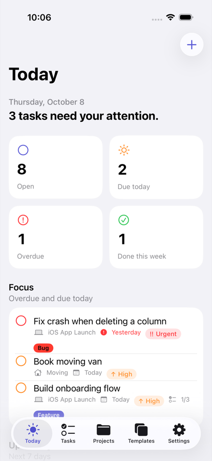
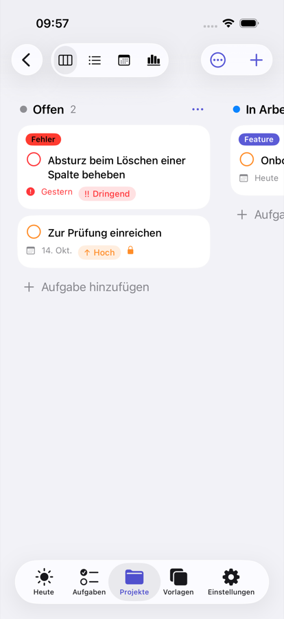
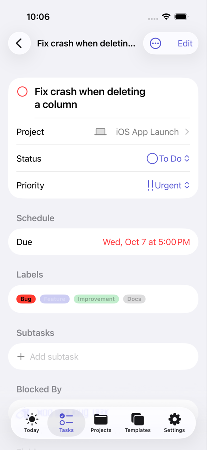
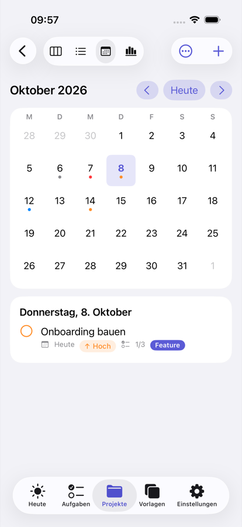

# Projects

A task manager for iPhone, iPad and Mac built with SwiftUI and SwiftData: Kanban boards, lists,
calendar and timeline per project, reminders you can act on, widgets, Siri/Shortcuts and iCloud sync.
Fully localized in **English and German**.

| Today | Board | Task | Calendar |
|---|---|---|---|
|  |  |  |  |

## Features

- **Workspaces → projects → tasks** with subtasks, comments, attachments, labels and activity history
- **Five project views**: Kanban board (drag & drop *and* an accessible "Move to" alternative), grouped list, table (filter by To Do / In Progress / Review / Done, always sorted by priority), month calendar, timeline
- **Task rules**: board columns map to statuses, dependencies ("Blocked By") with cycle detection – a blocked task stays in To Do until its blockers are done –, recurring tasks that create their next occurrence on completion, project-specific custom fields (text, number, date, checkbox, choice, link)
- **At a glance in every list**: people involved, open questions, blocked state, and a dot for comments (green while a comment synced from another device is unread)
- **Search, filters, sorting and paging** that run inside SQLite (`FetchDescriptor` predicates), bulk actions, undo for deletions
- **Reminders** with "Mark as Done" and "Remind Me in 1 Hour" actions right in the notification
- **Widget** "Today" (Home Screen, Lock Screen, macOS) with interactive completion
- **App Intents**: add, complete and open tasks from Siri, Spotlight and Shortcuts; tasks are indexed in Spotlight
- **iCloud sync** across the user's devices (private CloudKit database), JSON backup/restore, CSV export
- **macOS**: menu commands and keyboard shortcuts (⌘N, ⇧⌘N, ⌘F, ⌘1–4, Edit ▸ Undo), Settings window
- **Accessibility**: Dynamic Type, VoiceOver labels and actions, color contrast checks, no information conveyed by color alone

## Architecture at a glance

```
┌──────────────────────── App (Projects target) ────────────────────────┐
│ Features/ (SwiftUI views, @Query for reading)    App/ (composition root, │
│ Platform/ (notifications, Spotlight, widgets,    router, errors, toasts)│
│            sync status, MetricKit)               Intents/ (App Intents) │
└───────────────┬───────────────────────────────────────────────┬────────┘
                │ writes via services                          │
┌───────────────▼──────────── ProjectsKit (Swift package) ──────▼────────┐
│ ProjectsData: SwiftData schema (versioned), migrations, services       │
│ ProjectsDesignSystem: tokens and accessible components                 │
│ ProjectsCore: pure domain logic – no UI, no persistence                │
└────────────────────────────────────────────────────────────────────────┘
        ▲ shared with the widget extension through an App Group store
```

Reading uses `@Query` so views update automatically; every write goes through a service that
validates input, keeps board and status consistent, records activity, saves and notifies the
platform integrations. Details: [docs/ARCHITECTURE.md](docs/ARCHITECTURE.md) and the
[architecture decision records](docs/adr).

## Requirements

- Xcode 26.2 or later, iOS/iPadOS 26.2+, macOS 26.2+
- For iCloud sync and the widget on a device: an Apple Developer account (see [docs/RELEASE.md](docs/RELEASE.md))

## Getting started

```bash
open Projects.xcodeproj         # run the "Projects" scheme on "My Mac" or a simulator
```

The project builds and runs without an Apple Developer account ("Sign to Run Locally"). To sign
with your own team, copy the local configuration and fill in your values:

```bash
cp Config/Local.xcconfig.example Config/Local.xcconfig   # ignored by Git
```

```
DEVELOPMENT_TEAM = ABCDE12345            // your team ID
PROJECTS_BUNDLE_ID = com.example.Projects // a reverse-DNS identifier you own
```

The widget, test bundles, App Group and iCloud container are derived from these two values
([Config/Projects.xcconfig](Config/Projects.xcconfig)). No personal identifier is checked in.

The app starts empty, with a short onboarding. Without signing (e.g. in CI) the app falls back to
a local store. Debug builds can fill an in-memory store with a fixed sample data set for tests and
screenshots (launch arguments `-ui-testing -seed-demo-data`); release builds do not contain it.

## Quality

| Check | How | Status |
|---|---|---|
| Package tests (Core, Data, DesignSystem) | `cd Packages/ProjectsKit && swift test` | 185 tests |
| App unit + UI tests on iOS in **English and German** | `xcodebuild test -scheme Projects -destination 'platform=iOS Simulator,name=iPhone 17 Pro'` | 26 unit + 5 UI tests per language |
| App unit + UI tests on macOS in **English and German** | `xcodebuild test -scheme Projects -destination 'platform=macOS'` | 26 unit + 4 UI tests per language |
| Translations complete, format specifiers match | `scripts/check_localizations.py <DerivedData>` | 521 keys, 0 errors |
| Lint | `swiftlint lint --strict` | 0 findings |
| Compiler | Swift 6 language mode, strict concurrency | 0 warnings |

Line coverage (measured, not estimated): ProjectsCore 84 %, ProjectsData 87 %, ProjectsDesignSystem 48 %,
app target 37 % (mostly SwiftUI view code, which the UI tests exercise end to end).
CI runs all of the above on every push: [.github/workflows/ci.yml](.github/workflows/ci.yml).

Performance with 10,000 tasks (dashboard in 5.5 ms, filtered page in 12 ms): [docs/PERFORMANCE.md](docs/PERFORMANCE.md).

## Localization

All UI text lives in String Catalogs (`*.xcstrings`) per module, with plural rules and positional
arguments where German word order differs. The language follows the system setting
(per-app language on iOS: Settings ▸ Projects ▸ Language). See [ADR 0005](docs/adr/0005-localization.md).

## Project history

The first version of this project (March 2026) is preserved in the Git history (up to commit
`45eaae2`). Version 2 is a rewrite that replaced it with the architecture above; the reasons are documented in
[ADR 0001](docs/adr/0001-modular-architecture.md) and [ADR 0003](docs/adr/0003-single-user-scope.md).

## License

Released under the [MIT License](LICENSE).
