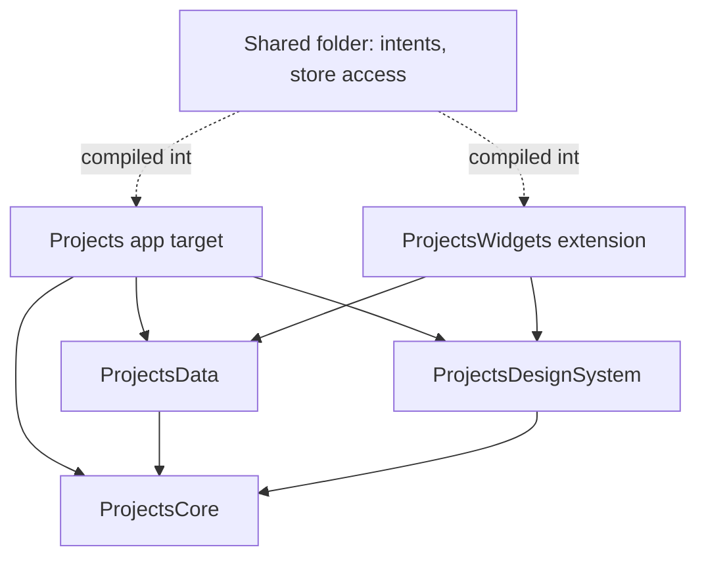

# Architecture

## Goals

1. **Correct data.** Invariants (a task's status matches its board column, deleting a comment never deletes anything else) are enforced in one place and covered by tests.
2. **Testable logic without a simulator.** Business rules live in a Swift package and run with `swift test` in seconds.
3. **Idiomatic SwiftUI.** Views read with `@Query` and stay reactive; there is no hand-written cache layer that can go stale.
4. **One app for iPhone, iPad and Mac** with platform conventions (tab bar vs. sidebar, menus and shortcuts on macOS).

## Modules



| Module | Contains | Depends on | Isolation |
|---|---|---|---|
| `ProjectsCore` | Enums (`TaskStatus`, `TaskPriority` …), `TaskFilter`, `RecurrenceRule`, `DependencyGraph`, `CalendarGrid`, `TimelineLayout`, `TaskStatistics`, `DeepLink`, `BackupDocument`, `CSVWriter`, `ProjectsError` | Foundation | nonisolated, `Sendable` value types |
| `ProjectsData` | SwiftData schema (`SchemaV1`, `SchemaV2`), migration plan, `PersistenceController`, services, `TaskQueries`, backup, sample data (debug builds only, for tests) | Core, SwiftData | nonisolated (`BackgroundStore` is a model actor) |
| `ProjectsDesignSystem` | Color/spacing tokens, badges, chips, progress, pickers, `FlowLayout` | Core, SwiftUI | `MainActor` |
| App (`Projects/`) | Composition root, router, features, platform integrations, App Intents | all modules | `MainActor` |
| `Shared/` | Store access for extensions, `TaskEntity`, `ToggleTaskCompletionIntent` | Data | – |
| `ProjectsWidgets` | "Today" widget | Data, DS | `MainActor` |

## Data flow

```
View ──@Query──────────────▶ SwiftData (reads, reactive)
View ──dependencies.tasks──▶ TaskService ──▶ ModelContext.save()
                                     │
                                     └─▶ TaskChangeObserving
                                           └─▶ PlatformTaskObserver
                                                 ├─ ReminderScheduler (local notifications)
                                                 ├─ SpotlightIndexer
                                                 ├─ WidgetRefresher
                                                 └─ dataVersion += 1 (dashboard statistics)
```

- **Reading**: list screens build `FetchDescriptor`s through `TaskQueries`, so filtering, sorting and paging run in SQLite. Detail screens take an identifier and resolve it with `@Query`, which makes deep links work and shows "not found" if something was deleted on another device.
- **Writing**: services are the only code that mutates models. They validate input (`Validation`), maintain invariants, record `ActivityEntry`s, save, roll back on failure and report a `ProjectsError`.
- **Errors**: every service error is a `ProjectsError` with a localized description and recovery suggestion. Views call `dependencies.errors.perform { … }`; the root view shows one alert. Unexpected errors are logged with `os.Logger` and shown generically.

## Composition root

`AppDependencies` creates the `ModelContainer` once (App Group store, iCloud if enabled and available, local fallback, recovery screen as last resort) and every service. It is injected with `.environment(_:)`; views never construct services. Tests and UI tests use `AppDependencies.makeInMemory(seed:)` with fake notification and search clients.

## Navigation

`AppRouter` owns the selected section, one `[Route]` path per section and the global sheet. Routes contain identifiers only. `DeepLink` (`projects://task/<id>`) is used by widgets, notifications, Spotlight, App Intents and "Share Link", and handled in one place.

## Persistence

See [ADR 0002](adr/0002-persistence-and-sync.md): CloudKit-compatible schema (defaults everywhere, optional relationships with explicit inverses, no unique constraints), parent-to-child cascades only, `VersionedSchema` + `SchemaMigrationPlan`, App Group store shared with the widget.

## Threads, processes and consistency

See [ADR 0006](adr/0006-concurrency-processes-and-identity.md).

- **Main context** (author `app`): views and the services in `AppDependencies`.
- **`BackgroundStore`** (a `ModelActor`, author `app.background`): backups, imports, CSV,
  attachments. Returns the affected task IDs for reminders, Spotlight and widgets.
- **Widget extension** (author `widget`): reads the store and completes tasks through an intent, then
  posts `StoreChangeSignal`.
- **`ExternalChangeReader`** brings changes of other authors into the main context (launch, becoming
  active, signal); **`ConsistencyService`** then restores the board invariants.
- **Sort keys** are sparse (`SparseOrder`), so a move writes one task.

## Testing strategy

| Layer | Tool | What is tested |
|---|---|---|
| Core | Swift Testing, parameterized | Rules and edge cases (month-end recurrence, Monday/Sunday week start, cycle detection, CSV escaping, deep link parsing) |
| Data | Swift Testing, in-memory store, fixed clock & calendar | Every delete rule, board/status invariants, recurrence, undo, backup round-trip, store predicate == reference filter (property-style), performance with 10k tasks |
| Design system | Snapshot tests (`ImageRenderer`, no dependency), unit tests | Components in light/dark, hex parsing, WCAG contrast |
| App | Swift Testing with fakes | Router, reminders, Spotlight, undo toast, notification actions, error presentation |
| UI | XCUITest via test plan in English and German | Create, complete, delete + undo, workspace → project → board, dashboard; launch time metric |
